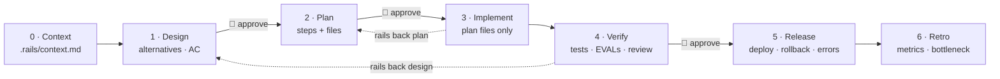

<h1 align="center">🛤️ Engineering Rails</h1>

<p align="center"><b>Your agent writes code fast. This skill makes it write the <i>right</i> code — on rails.</b><br>
<sub>Агент пишет код быстро. Этот скилл заставляет его писать <i>нужный</i> код — по рельсам.</sub></p>

<p align="center">
<a href="LICENSE"></a>


<a href="evals/RESULTS.md"></a>
</p>

**🇷🇺 [Читать на русском](README.ru.md)**

An agent skill that turns "just write me the code" into a repeatable engineering cycle — **context → design → plan → implement → verify → release → retro** — with gates enforced by a script, approvals that only a human can give, and a derail protocol that brings a vibe-coding session back on track without lecturing.

| Without Engineering Rails | With Engineering Rails |
|---|---|
| "Add promo codes" → agent hardcodes `SAVE10 = 10%` and ships | Agent drafts a design: stacking? expiry? limits? found that clients can already send any `discount` — asks *you* to decide |
| "Urgent, investors in 20 min, no tests!" → *"Тесты не запускал по вашему указанию."* | One message: stage, one-line risk, minimal design + plan with recommended answers, "~1 min to approve, ~5 min to build with a smoke test. Reply «да»." |
| "I spent 3 hours, checked manually, just wire it in" → wired in, two bugs shipped | Reads your module first: `loyalty.py:13` tier threshold uses `>`, `loyalty.py:19` float money. Turns your manual check into a repeatable test |
| Tests can't run → "done ✅" | Tests can't run → kept open, you choose: fix the env or accept the risk — recorded with your exact words |

Same model, same prompts — measured, not imagined: **[evals/RESULTS.md](evals/RESULTS.md)**.

---

## Why

Vibe coding and engineering look the same from the outside: a human talks to an agent and gets code. The difference is under the hood.

| | Vibe coding | Engineering |
|---|---|---|
| Goal | Generate a piece of code fast | Solve a business problem within constraints |
| Context | Empty chat or a couple of pasted files | Architecture, business rules, production, past decisions |
| Result | One-off code rewritten 100 times | A repeatable cycle that keeps delivering value |

Three lessons this skill encodes:
1. **Context decides everything.** An agent without architecture and business rules generates garbage — so stage 0 builds a project knowledge base from the code.
2. **Blind faith is dangerous.** Tests → EVALs → human review is the foundation of production — so verification needs evidence per acceptance criterion, not "should work".
3. **Process beats generation.** Value comes from a cycle without bottlenecks — so every stage is timed and the retro names the bottleneck.

## How it works



The process does not live in the agent's head. `scripts/rails.py` (Python stdlib, no dependencies) keeps state in `<project>/.rails/` and refuses to open a gate until its stage is really done:

| Gate | Checked deterministically |
|---|---|
| Context | every section filled from the code, no placeholders, `Актуально на:` date ≤ 30 days |
| Design | lane sections present; acceptance criteria as `AC-n: <fact> — проверка: <how>`; ≥ 2 alternatives for features; regression test for hotfixes; **human approval** |
| Plan | steps as `- [ ] S1: … — файлы: …`; no "run tests" pseudo-steps; **human approval** |
| Implement | all steps ticked; `git diff` ⊆ the plan's files; `rails.py can-edit <path>` before every edit |
| Verify | every AC → `PASS — <evidence>` or `RISK-ACCEPTED — … — человек: «…»`; EVALs section for LLM features; **human approval** |
| Release | deploy / rollback / error monitoring — or `N/A — <reason>` |
| Retro | `rails.py metrics --write`: time per stage, back-steps, the bottleneck |

**Lanes** keep it fast without skipping anything: `hotfix` (defect in existing behaviour), `small`, `feature`. Stages never disappear — they shrink. Small lanes approve design + plan in one answer. Urgency is not a lane. LLM/agent features (`--ai`) are always `feature` and require EVALs.

**Human gates** close only with the human's own words: `rails.py approve design --quote "<their reply>"`. A frustrated *"просто пиши код уже!"* is refused as an approval quote — the agent answers with the derail protocol instead.

### The derail protocol

When the human (or the agent) tries to leave the rails, the response is four moves, no lecture:

1. **Name the position** — task, lane, stage.
2. **One-line cost**, specific to this task ("you'd demo a double refund to investors").
3. **Fastest legal path** — smaller lane, artifact prefilled with recommended answers, the 2–3 questions that matter, a time estimate.
4. **Do it in the same message** — "Reply «да» or «поправь пункт N»."

A rationalization table captured *verbatim* from baseline runs ("Тесты не запускал по вашему указанию", "просто пиши код уже!" recorded as approval, "tests still blocked" on repeat) lives in [`references/derail-protocol.md`](skills/engineering-rails/references/derail-protocol.md).

## Install

**Claude Code** (plugin marketplace):
```
/plugin marketplace add t0uchY233/engineering-rails-skill
/plugin install engineering-rails@engineering-rails
```

**Any agent that reads project skills** (Claude Code, Codex CLI, Pi, and other `.agents/skills` readers):
```bash
git clone https://github.com/t0uchY233/engineering-rails-skill /tmp/engineering-rails
mkdir -p .agents/skills && cp -r /tmp/engineering-rails/skills/engineering-rails .agents/skills/
# Claude Code reads .claude/skills — link it once:
mkdir -p .claude/skills && ln -s ../../.agents/skills/engineering-rails .claude/skills/engineering-rails
```

Requirements: `python3` ≥ 3.8 and a shell. `git` is optional (enables the diff-scope check).

## Use

Just ask for code. The skill triggers on "add / fix / build / change …", on "just write the code", "quick fix", "no time for tests", and whenever a `.rails/` folder exists. It stays out of the way for questions, explanations, code review without changes and one-off shell commands.

What you will see from the agent:

```
Этап 1–2 (design+plan), полоса small.
Отличия от вашего запроса: нет.
Решения (рекомендую → можно иначе):
1. Колонки → id,customer,items,total,status
2. items → компактный JSON в одной CSV-ячейке
План: маршрут и выгрузка; HTTP-тесты.
Время: ~1 мин на согласование, ~5 мин на реализацию с тестами.
Ответьте «да» или «поправь пункт N».
```

`rails.py` is also a human tool:

```bash
python3 skills/engineering-rails/scripts/rails.py status    # where am I, what blocks the gate, what next
python3 …/rails.py metrics                                    # time per stage → the bottleneck
python3 …/rails.py list                                       # all tasks
```

<details>
<summary>All commands</summary>

| Command | What it does |
|---|---|
| `init` | create `.rails/` and the project context template |
| `start "<title>" --lane hotfix\|small\|feature --why "…" [--ai]` | open a task |
| `status` | current stage, blocking problems, next command |
| `check [stage]` | validate a stage's artifact |
| `approve <stage\|design+plan> --quote "…"` | record the human's approval |
| `advance` | move to the next stage if the gate passes |
| `back <stage> --reason "…"` | return to an earlier stage (approvals from there on are voided) |
| `lane <lane> --why "…" [--quote "…"]` | change lane; downgrade needs the human's words |
| `can-edit <path>…` | exit 0 only if editing these paths is allowed now |
| `metrics [--write]` | time per stage + bottleneck (optionally into the retro) |
| `list` / `switch <task>` | manage tasks |

</details>

## What's inside

```
skills/engineering-rails/
├── SKILL.md                    # the map: track, gates, approval format, derail red flags
├── scripts/rails.py            # state machine + deterministic gates (stdlib only)
├── references/
│   ├── stage-0-context.md … stage-6-retro.md   # step → key point → why, per stage
│   ├── lanes.md                # hotfix / small / feature
│   ├── derail-protocol.md      # pressure situations + verbatim rationalizations
│   └── ai-features.md          # EVALs and design for LLM/agent features
└── assets/templates/           # artifact templates (Russian)
tests/test_rails.py             # 23 unit tests for the gates
evals/                          # scenarios, trigger set, results
```

Artifacts are written in Russian (the templates' headings are what the gates check); the agent talks to you in your language. Instructions for the agent are in English.

## Limits — honestly

- Approvals are enforced by instructions plus a heuristic, not cryptography. An agent determined to fake a quote can.
- The pressure filter is heuristic; borderline replies rely on the agent's judgment.
- Evaluated on a small Python backend with two models; samples are small. See [evals/RESULTS.md](evals/RESULTS.md).

## Credits

- Pipeline: the 7-stage engineering pipeline for AI-agent development and the talk *"AI Engineering: Beyond Vibe Coding"*.
- Built and evaluated with [skill-conductor](https://github.com/smixs/skill-conductor) (CREATE loop, pressure testing, rationalization tables); domain knowledge on context, EVALs and harness design from [developing-ai-agents](https://github.com/ilkruglov/developing-ai-agents-skill).
- README layout inspired by [impeccable](https://github.com/pbakaus/impeccable) and [creative-director-skill](https://github.com/smixs/creative-director-skill).

## License

[MIT](LICENSE)
