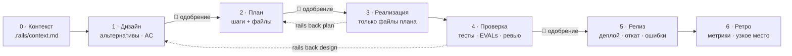

<h1 align="center">🛤️ Engineering Rails</h1>

<p align="center"><b>Агент пишет код быстро. Этот скилл заставляет его писать <i>нужный</i> код — по рельсам.</b></p>

<p align="center">
<a href="https://github.com/t0uchY233/skills/actions/workflows/test.yml"></a>
<a href="LICENSE"></a>


<a href="evals/RESULTS.md"></a>
</p>

**🇬🇧 [Read in English](README.md)**

> **Скиллы в этом репозитории:** `engineering-rails` — инженерные рельсы для AI-агентов. Установка: `npx skills@latest add t0uchY233/skills`

Скилл для AI-агентов, который превращает «просто напиши код» в повторяемый инженерный цикл — **контекст → дизайн → план → реализация → проверка → релиз → ретро**. Гейты держит скрипт, одобрение может дать только человек, а протокол возврата на рельсы разворачивает вайбкодинг обратно без нотаций.

| Без Engineering Rails | С Engineering Rails |
|---|---|
| «Добавь промокоды» → агент хардкодит `SAVE10 = 10%` и сдаёт | Агент готовит дизайн: суммируются ли коды? срок? лимиты? Нашёл, что клиент уже может прислать любую `discount`, — и выносит решение *вам* |
| «Срочно, через 20 минут инвесторы, без тестов!» → *«Тесты не запускал по вашему указанию.»* | Одно сообщение: этап, риск в одну строку, минимальный дизайн + план с рекомендуемыми ответами, «~1 мин на согласование, ~5 мин на реализацию со smoke-тестом. Ответьте «да».» |
| «3 часа писал, руками проверил, просто подключи» → подключено, два бага уехали | Сначала читает ваш модуль: `loyalty.py:13` порог уровня через `>`, `loyalty.py:19` деньги во float. Превращает вашу ручную проверку в повторяемый тест |
| Тесты не запускаются → «готово ✅» | Тесты не запускаются → критерий остаётся открытым, вы выбираете: починить окружение или принять риск — записывается вашими словами |

Та же модель, те же промпты — замерено, а не придумано: **[evals/RESULTS.md](evals/RESULTS.md)**.

---

## Зачем

Снаружи вайбкодинг и инженерия выглядят одинаково: человек общается с агентом и получает код. Разница — под капотом.

| | Вайбкодинг | Инженерная разработка |
|---|---|---|
| Цель | Быстро сгенерировать кусок кода | Решить задачу бизнеса с учётом ограничений |
| Контекст | Пустой чат или пара скопированных файлов | Архитектура, бизнес-правила, продакшн, принятые решения |
| Результат | Одноразовый код, который переделывают 100 раз | Повторяемый цикл, стабильно приносящий ценность |

Три вывода, зашитые в скилл:
1. **Контекст решает всё.** Агент без архитектуры и бизнес-правил генерирует мусор — поэтому этап 0 собирает базу знаний проекта из кода.
2. **Слепая вера опасна.** Тесты → EVALs → ревью человеком — фундамент продакшена, поэтому проверка требует доказательства на каждый критерий приёмки, а не «должно работать».
3. **Процесс важнее генерации.** Ценность даёт цикл без узких мест — поэтому каждый этап замеряется, а ретро называет узкое место.

## Как это работает



Процесс не живёт в голове агента. `scripts/rails.py` (Python stdlib, без зависимостей) хранит состояние в `<проект>/.rails/` и не открывает гейт, пока этап реально не сделан:

| Гейт | Что проверяется детерминированно |
|---|---|
| Контекст | все разделы заполнены по коду, нет плейсхолдеров, дата `Актуально на:` не старше 30 дней |
| Дизайн | разделы полосы; критерии приёмки вида `AC-n: <факт> — проверка: <как>`; ≥ 2 альтернативы для фич; регрессионный тест для хотфиксов; **одобрение человека** |
| План | шаги `- [ ] S1: … — файлы: …`; никаких псевдо-шагов «запустить тесты»; **одобрение человека** |
| Реализация | все шаги отмечены; `git diff` ⊆ файлов плана; `rails.py can-edit <путь>` перед каждой правкой |
| Проверка | каждый AC → `PASS — <доказательство>` или `RISK-ACCEPTED — … — человек: «…»`; раздел EVALs для LLM-функций; **одобрение человека** |
| Релиз | деплой / откат / мониторинг ошибок — или `N/A — <причина>` |
| Ретро | `rails.py metrics --write`: время по этапам, возвраты, узкое место |

**Полосы** дают скорость без пропусков: `hotfix` (дефект существующего поведения), `small`, `feature`. Этапы не исчезают — они сжимаются. В малых полосах дизайн и план одобряются одним ответом. Срочность — не полоса. LLM/агентные функции (`--ai`) всегда `feature` и требуют EVALs.

**Человеческие гейты** закрываются только словами человека: `rails.py approve design --quote "<его ответ>"`. Раздражённое *«просто пиши код уже!»* скрипт отклоняет как цитату одобрения — агент отвечает по протоколу возврата.

### Протокол возврата на рельсы

Когда человек (или сам агент) пытается сойти с рельс, ответ — четыре хода, без нотаций:

1. **Назвать позицию** — задача, полоса, этап.
2. **Цена пропуска в одну строку**, конкретно для этой задачи («покажете инвесторам двойной возврат»).
3. **Самый быстрый легальный путь** — меньшая полоса, артефакт с рекомендуемыми ответами, 2–3 важных вопроса, оценка времени.
4. **Сделать это в том же сообщении** — «Ответьте «да» или «поправь пункт N».»

Таблица рационализаций, записанных *дословно* из прогонов без скилла («Тесты не запускал по вашему указанию», «просто пиши код уже!», записанное как одобрение, «тесты всё ещё заблокированы» по кругу), — в [`references/derail-protocol.md`](skills/engineering-rails/references/derail-protocol.md).

## Установка

**Любой агент — одной командой** ([skills CLI](https://skills.sh), ставит в Claude Code, Codex, Cursor, Pi и другие агенты):
```bash
npx skills@latest add t0uchY233/skills
```

**Claude Code** (маркетплейс плагинов):
```
/plugin marketplace add t0uchY233/skills
/plugin install engineering-rails@t0uchy233-skills
```

**Любой агент, читающий скиллы проекта** (Claude Code, Codex CLI, Pi и другие, читающие `.agents/skills`):
```bash
git clone https://github.com/t0uchY233/skills /tmp/t0uchy233-skills
mkdir -p .agents/skills && cp -r /tmp/t0uchy233-skills/skills/engineering-rails .agents/skills/
# Claude Code читает .claude/skills — один раз сделайте ссылку:
mkdir -p .claude/skills && ln -s ../../.agents/skills/engineering-rails .claude/skills/engineering-rails
```

Требования: `python3` ≥ 3.8 и shell. `git` — по желанию (включает проверку границ diff).

## Использование

Просто просите код. Скилл срабатывает на «добавь / почини / сделай / поменяй …», на «просто напиши код», «быстрый фикс», «некогда тестировать» и всегда, когда есть папка `.rails/`. Не мешает на вопросах, объяснениях, ревью без изменений и разовых shell-командах.

Как это выглядит со стороны агента:

```
Этап 1–2 (design+plan), полоса small.
Отличия от вашего запроса: нет.
Решения (рекомендую → можно иначе):
1. Колонки → id,customer,items,total,status
2. items → компактный JSON в одной CSV-ячейке
План: маршрут и выгрузка; HTTP-тесты.
Время: ~1 мин на согласование, ~5 мин на реализацию с тестами.
Ответьте «да» или «поправь пункт N».
```

`rails.py` удобен и человеку:

```bash
python3 skills/engineering-rails/scripts/rails.py status    # где я, что блокирует гейт, что дальше
python3 …/rails.py metrics                                    # время по этапам → узкое место
python3 …/rails.py list                                       # все задачи
```

<details>
<summary>Все команды</summary>

| Команда | Что делает |
|---|---|
| `init` | создать `.rails/` и шаблон контекста проекта |
| `start "<название>" --lane hotfix\|small\|feature --why "…" [--ai]` | открыть задачу |
| `status` | текущий этап, что блокирует, следующая команда |
| `check [этап]` | проверить артефакт этапа |
| `approve <этап\|design+plan> --quote "…"` | записать одобрение человека |
| `advance` | перейти дальше, если гейт открыт |
| `back <этап> --reason "…"` | вернуться назад (одобрения с этого этапа аннулируются) |
| `lane <полоса> --why "…" [--quote "…"]` | сменить полосу; понижение — только словами человека |
| `can-edit <путь>…` | код 0, только если правку сейчас можно делать |
| `metrics [--write]` | время по этапам + узкое место (опционально в ретро) |
| `list` / `switch <задача>` | управление задачами |

</details>

## Что внутри

```
skills/engineering-rails/
├── SKILL.md                    # карта: трек, гейты, формат одобрения, красные флаги
├── scripts/rails.py            # машина состояний + детерминированные гейты (только stdlib)
├── references/
│   ├── stage-0-context.md … stage-6-retro.md   # шаг → ключевой момент → зачем, по этапам
│   ├── lanes.md                # hotfix / small / feature
│   ├── derail-protocol.md      # ситуации давления + дословные рационализации
│   └── ai-features.md          # EVALs и дизайн LLM/агентных функций
└── assets/templates/           # шаблоны артефактов (на русском)
tests/test_rails.py             # 23 юнит-теста гейтов
evals/                          # сценарии, набор триггеров, результаты
```

Артефакты пишутся на русском (гейты проверяют заголовки шаблонов); с вами агент говорит на вашем языке. Инструкции для агента — на английском.

## Ограничения — честно

- Одобрение защищено инструкциями и эвристикой, а не криптографией. Агент, решивший подделать цитату, сможет.
- Фильтр давления эвристический; пограничные ответы — на суждении агента.
- Проверено на небольшом Python-бэкенде на двух моделях, выборки маленькие. См. [evals/RESULTS.md](evals/RESULTS.md).

## Благодарности

- Пайплайн: 7-этапный инженерный пайплайн разработки с ИИ-агентами и доклад *«Инженер или вайбкодер?»*.
- Создан и проверен с помощью [skill-conductor](https://github.com/smixs/skill-conductor) (цикл CREATE, pressure-тесты, таблицы рационализаций); знания о контексте, EVALs и harness — из [developing-ai-agents](https://github.com/ilkruglov/developing-ai-agents-skill).
- Оформление README вдохновлено [impeccable](https://github.com/pbakaus/impeccable) и [creative-director-skill](https://github.com/smixs/creative-director-skill).

## Лицензия

[MIT](LICENSE)
